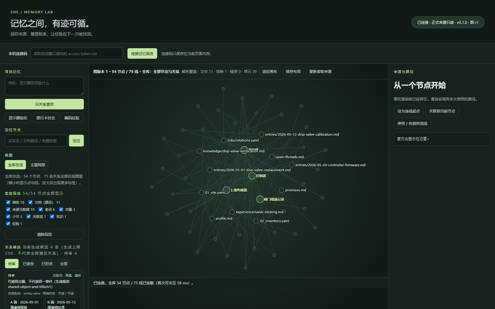
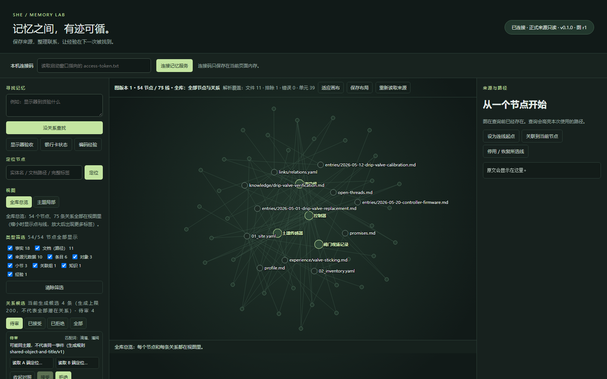
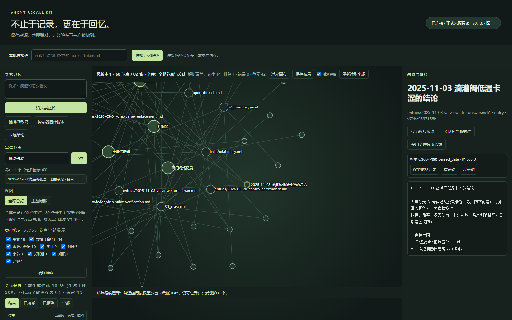

# Agent Recall Kit

[简体中文](README.zh-CN.md) | **English**

### Beyond storing memories—recalling them when they matter.

[Quick start](#quick-start) · [Connect an agent](#connect-an-agent) · [Documentation](#documentation) · [MIT License](LICENSE)

---

## What is Memory?

In Chinese, the word for memory is **记忆**. I like to think of its two characters as two parts of the same process:

**记 (jì)**: recording and preserving experiences.
**忆 (yì)**: finding those experiences again when they matter.

My previous project, [Agent Memory Kit](https://github.com/Kreuz-sp/agent-memory-kit), shared an approach to organizing an agent's memory library. It focused mainly on the first part: helping an agent record, organize, and preserve its experiences.

**But storing something does not mean being able to recall it.**

As memories accumulate, how do we find the right ones? How do we discover connections between them? And how can past experiences become useful in a new conversation or task?

That is the part Agent Recall Kit explores: **recall**.

## What is Agent Recall Kit?

Agent Recall Kit is a standalone, local memory toolkit for personal agents, with relationship graphs, retrieval, and visual management.

Building on the memory-library ideas behind Agent Memory Kit, it creates a graph over Markdown and YAML source files. Agents can retrieve related experiences, check their sources, and use past knowledge in the task at hand.

The project provides an MCP interface and is designed to work independently of any particular LLM or agent. MCP-compatible hosts can access the same local memory service.

MCP connectivity and memory reading have been tested with **DSH, Codex, and Cherry Studio**. Compatibility still depends on the host, version, model, and configuration. Connecting tools does not make them run automatically on every turn.

## Why Another Memory System?

In the personal agent I envision, cognition and memory should be relatively independent:

- **Cognitive Brain**: the LLM provides understanding, reasoning, planning, and expression.
- **Memory Brain**: preserves, organizes, connects, and retrieves experiences.

Models can change and conversations can end, while accumulated memories should remain available.

We should be able to change how an agent thinks without having to get to know it all over again.

Agent Recall Kit grew out of that idea.

## A Personal Project, An Open Exploration

This project began as an exploration of personal companion agents.

I want to share both a working tool and a way of thinking about long-term agent memory.

There is still plenty to explore and improve. Where this project goes next is something I hope to discover with other developers.

Try it, ask questions, share your ideas, or help improve it.

**Help agents do more than record experiences—help them recall them.**

---

## Watch a Memory Network Grow

[](docs/media/recall-growth.mp4)

[Watch the 20-second video](docs/media/recall-growth.mp4) · Silent · 1080p

The video shows the scale and shape of the author's actual graph: approximately 2,800 nodes and 4,800 relationships, without node identifiers, titles, or memory text. The growth sequence is illustrative, not a historical replay. The interface screenshots below use the fictional demo library included in this repository.

## What Can It Help an Agent Recall?

Project decisions, why an operation failed, a method that worked, or an unfinished task can live in a shared library rather than being scattered across chat windows.

Examples from the bundled demo:

| Question | Retrieved evidence |
|---|---|
| What model is the irrigation valve? | The relevant fact record and its source location |
| What firmware version does the controller use? | The version stored in the configuration record |
| What was the conclusion about cold-weather valve sticking? | The original notes and conclusion |

These questions are translated here for explanation. The bundled demo documents and tested example queries are in Chinese; this is not a claim that English retrieval has been validated.

The service returns evidence for the connected model to interpret. Missing evidence and ambiguous candidates remain visible in the results.

### Recall the Information—and Its Source

Source units retain their file location and version. Fetch the original text when you need to check it. If a file changes, requests using an outdated source version are rejected rather than returning stale text as current evidence.

### See How Memories Connect

Browse the full graph, zoom, search, drag nodes, save layouts, and edit relationships. The service proposes potentially related memories; you compare the two sources before accepting or rejecting a proposal. Your decisions persist across restarts.



<details>
<summary>Reviewing relationship candidates</summary>



Shared words are clues, not proof that two records describe the same event.

</details>

### Let Everyday Experiences Fade Without Losing Them

Ordinary experiences gradually receive lower retrieval priority, while their original text remains available. Facts, knowledge, reusable experience notes, tasks, and promises are protected by default. Individual experiences can also be pinned.

Explicit historical queries bypass decay. When a memory actually helps, an explicit helpfulness report can reactivate it. Searching, reading, or clicking a memory does not reinforce it automatically.

<details>
<summary>How does decay affect ranking?</summary>

The default weight is:

```text
w(t) = 0.35 + 0.65 × 2^(−t/90)
```

Here, `t` is the number of days since the memory's timestamp or its latest effective reinforcement. The portion above the floor halves every 90 days; the weight never drops below 0.35. The demo profile uses 60 days to make the effect easier to observe. These are configurable product defaults, not findings from cognitive science.

Candidates are grouped relative to the highest base relevance score in the current query: strong at ≥90%, related at ≥60% and <90%, and weak below 60%. Tier order is preserved. Within each tier, candidates are ordered by **base relevance × activation weight**. A newer record may therefore outrank a slightly more relevant older record within the same tier. Age alone neither resolves ambiguity nor filters an otherwise eligible record out of retrieval.

Time is taken from explicit metadata, a date in the entry filename/title, or the first-seen timestamp, in that order—not from file modification time. Explicit history queries, unit references, and verbatim citations bypass decay without updating reinforcement time.

A pinned memory has weight 1. Unpinning returns it to its original timeline rather than resetting its age. Only effective `helpful` feedback reactivates it, at most once per unit per UTC day. `not_helpful` records feedback without penalizing the memory. Feedback events bind the unit, source version, and result; identical replays do not write again, and reusing an event ID with different content produces a conflict.



</details>

## Quick Start

This is the **0.1.0 preview release**. Windows 11, Python 3.12/3.13, and Edge have been tested. Linux and macOS have not yet been validated.

Run in PowerShell:

```powershell
git clone https://github.com/Kreuz-sp/agent-recall-kit.git
cd agent-recall-kit

python -m venv .venv
.venv\Scripts\python.exe -m pip install .

# Create a data directory with fictional demo material
.venv\Scripts\agent-recall-kit.exe init .\my-data --demo

# Build the graph from the source files
.venv\Scripts\agent-recall-kit.exe --config .\my-data\agent-recall-kit.json build

# Start the local service
.venv\Scripts\agent-recall-kit.exe --config .\my-data\agent-recall-kit.json serve --port 18791
```

Open **http://127.0.0.1:18791** and enter the access code from:

```text
my-data/data/runtime/access-token.txt
```

Keep the terminal open while the service runs; press `Ctrl+C` to stop it. For background operation and an optional Windows scheduled task, see [Operations](docs/OPS.md).

Data is stored separately from the installed package:

```text
my-data/
  agent-recall-kit.json   Configuration
  library/               Markdown / YAML source files
  data/graph/            Graph, review decisions, activation state
  data/runtime/          Access code, layouts, runtime state
```

For your own material, omit `--demo`, organize your files according to the [data format](docs/FORMAT.md), and configure a [profile](docs/PROFILE.md) for your domain. After changing source files, run `build` again or use the interface's refresh action.

The current demo and interface screenshots are in Chinese. This English README does not imply a fully localized English interface.

## Connect an Agent

The memory service runs locally. An MCP stdio bridge exposes it to compatible hosts; multiple hosts can share the same service.

```text
Agent / MCP host → stdio bridge → local memory service → library and graph
                                         ↑
                                  browser interface
```

Set the command and arguments in your host's MCP settings, using your own absolute paths:

```text
Command: <repository-path>/.venv/Scripts/agent-recall-kit-mcp.exe
Arguments: --config <data-directory>/agent-recall-kit.json --service http://127.0.0.1:18791
```

| Tool | Purpose |
|---|---|
| `memory_query` | Retrieve memories, citations, and relationship paths |
| `memory_fetch` | Read original text by unit ID and source version |
| `memory_explain` | Inspect the retrieval process |
| `memory_health` | Check connectivity and service status |
| `memory_feedback` | Explicitly report usefulness and write activation metadata |

See [MCP setup](adapters/mcp/README.md) for JSON configuration. Connectivity and reading have been tested in DSH, Codex, and Cherry Studio; verify your specific host version and model. The model or host decides when to call tools. This release does not include automatic per-turn memory injection.

## Your Data Stays Under Your Control

- Source files are read-only. Graph state, layouts, and feedback are stored separately. Decay does not delete the originals.
- The service listens on localhost by default and generates its access code locally. See [backup and restore](docs/OPS.md) for moving or preserving your data.
- Domain aliases and evidence rules need configuration. Relationship proposals require review, and retrieval can still miss relevant material or return irrelevant candidates.

Preview interfaces and data formats may change. Concurrent writers to the same data directory, other operating systems, and other browsers have not been fully validated. See [Known limitations](docs/LIMITS.md).

## Documentation

The detailed documents below are currently in Chinese.

| Document | Contents |
|---|---|
| [Data format](docs/FORMAT.md) | Source organization, units, and versions |
| [Domain profiles](docs/PROFILE.md) | Aliases, target fields, retrieval, and evidence rules |
| [HTTP API](docs/API.md) | Queries, graph operations, feedback, and errors |
| [MCP setup](adapters/mcp/README.md) | Commands, arguments, and tools |
| [Operations](docs/OPS.md) | Service control, diagnostics, backups, recovery, and supervision |
| [Known limitations](docs/LIMITS.md) | Tested scope and current gaps |

## License

[MIT](LICENSE) · Copyright © 2026 Kreuz-sp

The internal Python import name remains `she_memory`. The distribution name and command prefix are `agent-recall-kit`.
