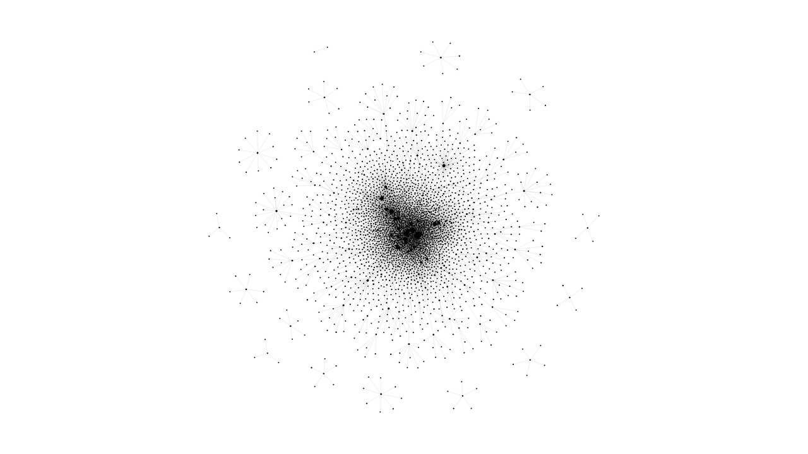

# Agent Recall Kit

> **不止于记录，更在于回忆。**

本地、可追溯的 Agent 记忆工具包 · 0.1.0 预览版

本地、可追溯的记忆服务预览版：把你的 Markdown/YAML 资料读成一张**带来源**的图，
在浏览器里全库浏览、按关系检索、逐条审核自动生成的关系候选；
程序只读你的原件，人工决定单独存放，可导出备份。

> **状态**：预览版（0.1.0），接口与数据格式仍可能变化。
> 许可证 MIT，署名见 `LICENSE` 与 `pyproject.toml`。

**它不做什么**：不自带任何人格或聊天助手；不声称"任意问法都能准确召回"；
不把可编辑关系图说成神经网络或意识；不改写你的记忆原件。

---


## 从一点联系，到一张记忆网络

[](docs/media/recall-growth.mp4)

[观看 / 下载演示视频（20 秒 · 1080p · 无声）](docs/media/recall-growth.mp4)

白底、黑点、细线，从稀疏联系逐渐长成复杂网络。**不展示节点标识、标题或记忆正文**，仅呈现约 2800 个节点、4800 条关系的规模与形态；生长顺序为示意编排，并非历史录像。下方截图则来自本仓库的虚构演示库，两者来源不同。


## 它解决什么

- **来源可追溯**：每个节点要么是来源单元（带 `path:line` 与 `source_version`），要么是文档/对象/关系组；检索结果能点回原文并按版本校验。
- **全库总览**：一次取回整张图（当前演示库约 50 节点，作者自用库约 2800 节点），可缩放、平移、搜索定位、按类型筛选。
- **候选审核**：机器只提"可能同主题"的候选，必须人看两端原文再接受/拒绝；接受与否决都记在快照里，重启不丢。
- **只读来源**：`source-readonly` 模式下程序不写你的资料目录；人工决定写在数据目录的图快照里。
- **可选的 MCP 桥**：给支持 MCP 的宿主（如 Claude Desktop、Codex、DSH、Cherry Studio）提供查询/取原文工具；默认不启用"每轮自动供给"。

## 截图（来自本仓库的虚构演示库）

| 文件 | 内容 |
|---|---|
| `docs/images/overview.png` | 全库总览（适应画布） |
| `docs/images/local.png` | 主题局部（标注"显示 X/Y"） |
| `docs/images/candidate.png` | 候选审核：A/B 两端原文对照 |
| `docs/images/missing-source.png` | 一端来源缺失：接受被禁用，B 端仍可读 |

演示库是**纯虚构**的（人物、项目、设备、日期都是编的），见 `examples/demo-library/`。

## 五分钟快速开始（Windows，实测 Py3.12/3.13）

```powershell
# 1) 装（在仓库根目录运行）
python -m venv .venv
.venv\Scripts\activate
python -m pip install .
# 也可以先打包再装 wheel：python -m pip install build; python -m build; pip install dist\agent_recall_kit-0.1.0-py3-none-any.whl

# 2) 建数据目录，直接带虚构演示库（配置、图状态、连接码都放这里，不写源码树）
agent-recall-kit init .\my-data --demo
# 生成的结构：
#   my-data\agent-recall-kit.json     ← 配置（memory_root/profile/state_root/view_root 都在这里）
#   my-data\library\            ← 资料目录（演示库写在这里）
#   my-data\data\graph\         ← 图快照（state_root）
#   my-data\data\runtime\       ← 连接码、布局、日志（view_root）

# 3) 建图（唯一写图的入口）
agent-recall-kit --config .\my-data\agent-recall-kit.json build
# {"revision": 1, "units": 39, "nodes": 54, "edges": 75}

# 4) 启动（只监听 127.0.0.1；首次启动生成连接码）
agent-recall-kit --config .\my-data\agent-recall-kit.json serve --port 18791

# 5) 浏览器打开 http://127.0.0.1:18791
#    连接码在 .\my-data\data\runtime\access-token.txt
```

用自己的资料时，跳过 `--demo`：`agent-recall-kit init .\my-data` 会建空库骨架，
再把你的 Markdown/YAML 放进 `my-data\library\`，然后跑 `build`。

命令行也能用：

```powershell
agent-recall-kit --config .\my-data\agent-recall-kit.json query "滴灌阀 型号"
agent-recall-kit --config .\my-data\agent-recall-kit.json fetch --unit unit:... --version <sha256>
agent-recall-kit-ctl --config .\my-data\agent-recall-kit.json status
agent-recall-kit-doctor --config .\my-data\agent-recall-kit.json
```

## 淡忘与再激活（本版新增）

普通经历（`kind=entry`）会随时间慢慢沉到检索后面；**原文、节点、边、证据都不会消失**，明确查历史仍然找得到。
重要事实、约定、待办、知识/经验默认受保护；也可以对单条记录 **pin**。

- 权重：`floor + (1-floor) * 2^(-age_days/half_life_days)`，首版默认 `half_life=90 天`、`floor=0.35`。
  这是产品初始值，不是从人脑研究推出来的。
- 时间依据优先级：显式元数据 → 文件名/标题里解析器认可的日期 → 首次入库时间；返回里带 `time_basis`，
  **不拿文件 mtime 冒充经历时间**，复制/迁库/刷新/改正文都不重置年龄。
- 衰减只影响**同一相关度层级内**的顺序：无关的新记录不能靠新鲜盖过明确匹配的旧记录，也不会把旧记忆变成 `no_match`。
- `ambiguous` / 冲突不会按年龄消解；「旧」「新」不证明是同一件事。
- 只有明确反馈 **helpful** 才重新活跃（`event_id` 幂等、同单元同 UTC 日最多一次）；`not_helpful` 只记账、不惩罚。
  query / fetch / 预览 / 点击节点都不会自动强化。
- 管理界面有「活跃程度」开关（只调透明度，最低 0.45，低活跃节点仍可点开读原文）、保护/取消保护、
  有帮助/没帮助按钮；详情里显示权重、时间依据、最近有用反馈。

```powershell
agent-recall-kit --config .\my-data\agent-recall-kit.json feedback `
  --unit <unit_id> --version <source_version> --event evt-001 --result helpful
agent-recall-kit --config .\my-data\agent-recall-kit.json pin --unit <unit_id>
agent-recall-kit --config .\my-data\agent-recall-kit.json unpin --unit <unit_id>
```

## 已验证环境

| 项 | 实测 |
|---|---|
| 平台 | Windows 11（本机）；Python **3.12.10** 与 **3.13.15** 各自全新 venv 装 wheel 跑通 |
| 最低版本 | `requires-python = ">=3.12"`；3.10/3.11 **未验证**，不承诺可用 |
| 浏览器 | Microsoft Edge 156（headless 实跑：加载、缩放、拖拽、搜索、候选对照） |
| 安装 | 全新 venv + 安装 wheel，数据目录在 `%TEMP%` 下，与作者环境无引用 |
| MCP 宿主 | **Cherry Studio（Grok）实测**：MCP 直连本服务，`memory_query` / `memory_fetch` 走通（含按版本取原文）；只读，不自动注入上下文 |
| 规模 | 演示库 54 节点；合成大图约 2600 节点（`examples/generate_synthetic.py`） |
| 未验 | Linux/macOS 安装、非 Edge 浏览器、多进程同时写同一数据目录 |

## 目录结构

```
src/she_memory/       核心（阅读器、图、查询、HTTP 服务）与随包前端 web/
                      ⚠️ Python 导入名仍是 she_memory，未随品牌改名（0.1 保持兼容）
examples/demo-library/ 纯虚构演示资料
examples/config/       可直接使用的示例配置（agent-recall-kit.json）与演示 profile
adapters/              MCP 接入配置、可选 Windows 守护任务
tests/                 隔离测试（临时目录、临时端口）
docs/                  格式、profile、接口、运维、限制
```

## 文档

- 数据格式与单位身份：`docs/FORMAT.md`
- 领域规则（对象/目标/证据规则）怎么写：`docs/PROFILE.md`
- HTTP 接口与状态：`docs/API.md`
- 启停、体检、备份与恢复、可选守护：`docs/OPS.md`
- 已知限制（必读）：`docs/LIMITS.md`

## 安全与边界

- 默认只监听 `127.0.0.1`，每次启动时若没有连接码就在数据目录生成一个（`access-token.txt`），不随包分发、不写入仓库。
- 来源为**只读**：所有写操作只落在数据目录的图快照/布局文件里。
- 端口独占只保证"同一端口只有一个服务"；**不代表**同一数据目录可以被多个进程同时写——这一点未验证，见 `docs/LIMITS.md`。

## 许可与出处

MIT，见 `LICENSE`（Copyright © 2026 Kreuz-sp）。版本号以 `pyproject.toml` 为准，
源码、包元数据、构建产物与本文保持一致（0.1.0，预览版）。

首发范围保持精简：**不含**经验草稿工具（`experience`）、一次性迁移脚本，
也**不含** DSH/Codex 的每轮自动供给——这些暂未纳入，不承诺时间。
